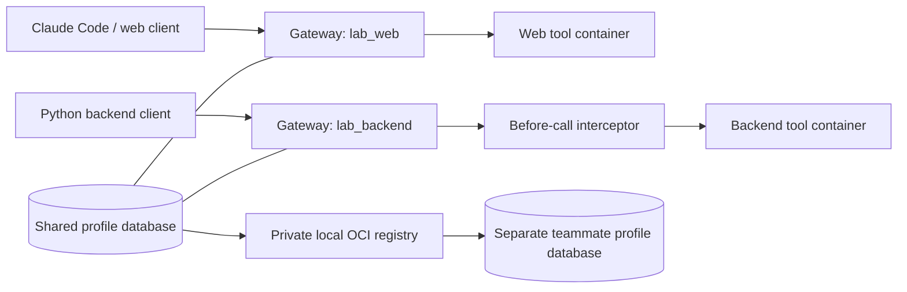

# Docker MCP Profiles Lab

Give a web client and a backend client different tools through Docker MCP Gateway,
intercept a tool call, inspect the containers that execute it, and share the
profiles through a real OCI registry.

The examples use deterministic local data. There are no API keys, database
accounts, model subscriptions, or real deployments required for the Python
walkthrough. Claude Code is an optional second client.

## What you will learn

- A profile selects server definitions and allowed tools. It is not a container.
- Each stdio client launches its own gateway process; both gateways reuse the same
  profile database. “One gateway” here means one integration interface, not one
  shared daemon or a multi-tenant authorization service.
- Docker runs the tool servers as separate containers. The gateway manages their
  lifecycle and applies CPU and memory limits.
- A `before:exec` interceptor can return a tool error before the server is called.
- A profile is an OCI artifact containing configuration, **not the server images**,
  client configuration, interceptor script, or credentials.



## Prerequisites

- Docker Desktop or Docker Engine with Docker Compose v2, running Linux containers.
- Python **3.12** and a POSIX shell (macOS, Linux, or WSL2).
- Network access for the initial image and Python dependency downloads.
- Optional: Claude Code, already authenticated, for the interactive client step.

The lab pins Docker MCP Gateway **v0.44.3** by digest and locks Python dependencies
with hashes. It runs the gateway in a container, so you do not need to upgrade your
installed `docker mcp` CLI or change your personal MCP profiles. The gateway and
profiles are still beta features; the lab intentionally targets this version.

The gateway needs the Docker socket to start sibling tool containers. This grants
it control of the Docker engine. Run this on a development machine with code you
trust. The tool containers receive neither that socket nor your project directory.
The included tools process only supplied HTML and a tiny in-memory SQL fixture;
there is no arbitrary URL fetch, arbitrary SQL, or deployment action.

## Run it

From the repository root:

```sh
python3.12 -m venv .venv
.venv/bin/python -m pip install --require-hashes -r requirements.txt
.venv/bin/python scripts/setup.py
.venv/bin/python clients/explore.py web
.venv/bin/python clients/explore.py backend
.venv/bin/python scripts/verify.py
```

If you use `uv`, `uv venv --python 3.12 .venv` and
`uv pip sync --python .venv/bin/python --require-hashes requirements.txt` are equivalent.

Setup builds two images, starts a registry without publishing any host ports,
and imports `lab_web` and `lab_backend` into a dedicated Docker volume. It also
writes an optional Claude configuration to `.local/claude.mcp.json`. Your personal
Docker credentials and MCP configuration are not mounted into the lab.

Expected example results:

| Profile | Tool | Example result |
| --- | --- | --- |
| `lab_web` | `page_outline` | Two headings: `Docker`, `Profiles` |
| `lab_backend` | `order_summary` with `west` | 2 orders, 3,750 cents |
| `lab_backend` | `release_preview` with `staging` | Preview only; no changes applied |
| `lab_backend` | `release_preview` with `production` | Interceptor returns a policy error |

The tools are deliberately small so the Docker behavior is easy to observe.
`release_preview` never deploys anything, even without the interceptor.

## Inspect the profiles and containers

Use the same gateway CLI as the clients:

```sh
docker compose run --rm -T toolkit profile list --format json
docker compose run --rm -T toolkit profile show lab_backend --format json
```

`profiles/web.json` and `profiles/backend.json` are the source definitions. Edit
them and rerun setup to update the lab. Only these named lab profiles are imported.
The two profiles have explicit tool allowlists.

The containerized CLI calls the same implementation as `docker mcp profile ...`.
It stores its state in the `toolkit-state` volume; the `teammate` service uses a
separate volume. `profiles/docker-config.json` disables dynamic management tools,
so a connected client cannot add servers or activate a different profile through
those gateway tools. This is necessary to make the demonstrated tool sets stable.

While a client connection is open, inspect server containers:

```sh
docker ps --filter label=io.github.mcp-profiles-lab.component=tool-server
# Substitute one ID from the output:
docker inspect CONTAINER_ID --format '{{json .HostConfig}}'
```

For a hands-on pause, run `scripts/gateway.sh backend` in one terminal. It keeps
stdin open until you press Ctrl-D; inspect its tool container from another terminal.
The Python verification script also saves a compact inspection in
`.local/verification.json`.

**Observed lifecycle:** the gateway starts containers during tool discovery,
before the first `tools/call`. Do not describe it as starting a server *only* when
a tool is invoked. The wrapper uses `--long-lived` to reuse each server for the
client session, then removes it on disconnect. This is a deliberate setting for
inspection, not a claim about every gateway mode.

The verified tool containers run as UID/GID `10001:10001`, are not privileged,
and have limits of **1 CPU and 256 MiB**. This lab does not claim that all Linux
capabilities are dropped, that the root filesystem is read-only, or that network
egress is denied. Profiles are not a substitute for hostile-code isolation.

## Connect Claude Code and another client

The Python client above is a real MCP SDK client: it initializes a session,
discovers tools, and calls them through the Docker gateway. It can use either
profile. To give Claude the web profile and Python the backend profile:

```sh
claude --strict-mcp-config --mcp-config .local/claude.mcp.json
# In Claude, ask it to call page_outline with:
# <h1>Docker MCP</h1><h2>Profiles</h2>

# In another terminal:
.venv/bin/python clients/explore.py backend
```

Approve the project/tool connection in Claude when prompted. The strict flag
limits that Claude session to the supplied MCP configuration; this does not edit
its global configuration. Claude model usage follows your existing plan.
Generated absolute paths stay under `.local/` and are not committed. Setup can
regenerate them after moving the checkout. Any stdio MCP client can use the same
`scripts/gateway.sh web` or `scripts/gateway.sh backend` command.

## Understand the interceptor

`scripts/gateway.sh` runs this interceptor inside the gateway container:

```text
--interceptor=before:exec:/lab/scripts/policy.sh
```

For the pinned gateway, stdin is a serialized Go SDK request with `Params.name`
and `Params.arguments`. The script also accepts lowercase `params` for the older
example format. Empty stdout means “continue”; a JSON MCP `CallToolResult` on
stdout replaces the call. Logs go to stderr. Malformed requests fail closed.

The policy blocks a production `release_preview`, while allowing staging and the
read-only tools. It logs tool names, not user HTML or arguments. This is a small
example policy, not a complete authorization system. Anyone who controls the
Docker host or the gateway configuration can change or remove it.

## Share through an OCI registry

The registry is internal to the Compose project. The CLI services share its
network namespace, so `localhost:5000` below refers to that container, not a host
port. No registry account or public upload is involved.

```sh
docker compose run --rm -T toolkit profile push lab_web localhost:5000/profiles/web:v1
docker compose run --rm -T teammate profile pull localhost:5000/profiles/web:v1
docker compose run --rm -T teammate profile show lab_web --format json
```

The verifier does this for **both** profiles, compares the imported server
configuration, and executes a tool through each imported profile. It removes only
matching `lab_web` / `lab_backend` profiles from the dedicated teammate database
before pulling, making verification repeatable. A manual second `pull` of the same
name fails rather than updating it; remove that disposable teammate profile first.

For a teammate on another machine, clone this repository and run setup to build
the same server images, then exchange exported profiles or use a private registry
that both machines can reach. Export a profile with:

```sh
docker compose run --rm -T toolkit profile export lab_web /exports/web.json
```

The file appears at `.local/exports/web.json`. For registry distribution without
rebuilding, publish the **two server images separately**, use their registry digest
references in both the profile's `image` and `snapshot.server.image`, then push
the profile artifact. Provision registry credentials on the destination and
install the interceptor/client wrapper there too. A profile push alone cannot
make local image tags available on a teammate's Docker engine. The built-in
round-trip verifies two profile databases on **one engine**, not a remote host or
an authenticated enterprise registry.

## Validation and evidence

`verify.py` is an executable tutorial walkthrough, not a production test suite.
Close other lab clients first. It checks real sessions, results, error paths,
resource limits, teardown, and OCI round-trips. Failure returns a nonzero exit
code and retains evidence; partial success is not a passing run.

- `.local/verification.json`: results and container settings.
- `.local/toolkit-*.log`: gateway and interceptor diagnostics.
- `.local/teammate-*.log`: sessions using imported profiles.
- [Validation notes](docs/validation.md): reviewed scope and tested environment.

Run `scripts/verify.py` after changing tools, profiles, policies, or image settings.
The registry may retain the small sample profile artifacts until cleanup.

## Cleanup

Close Claude and other lab clients first, then run:

```sh
docker compose down --volumes --remove-orphans
```

This removes this Compose project's registry, networks, and profile/registry
volumes. It does not delete your personal MCP state or other projects. The two
locally built images and downloaded base images remain cached. Remove the two
lab images if desired:

```sh
docker image rm mcp-profiles-lab/web:1 mcp-profiles-lab/backend:1
```

If an interrupted client left a tool container, inspect its label and ID before
removing that specific lab container. Do not run a global Docker prune.

## Files

| Path | Purpose |
| --- | --- |
| `compose.yaml` | Isolated CLI state, local registry, and image builds |
| `Dockerfile`, `servers/server.py` | Non-root web/backend MCP server images |
| `profiles/` | Profile definitions and disabled dynamic management tools |
| `scripts/gateway.sh`, `scripts/policy.sh` | Client entrypoint and call policy |
| `scripts/setup.py`, `scripts/verify.py` | Setup and executable verification |
| `clients/explore.py` | Small Python MCP client |
| `requirements.in`, `requirements.txt` | SDK dependency and hash-locked resolution |

## References

- [Docker MCP profiles](https://docs.docker.com/ai/mcp-catalog-and-toolkit/profiles/)
- [Docker MCP CLI](https://docs.docker.com/ai/mcp-catalog-and-toolkit/cli/)
- [Pinned gateway source](https://github.com/docker/mcp-gateway/tree/v0.44.3)
- [Gateway interceptor implementation](https://github.com/docker/mcp-gateway/blob/v0.44.3/pkg/interceptors/interceptors.go)
- [MCP Python SDK](https://github.com/modelcontextprotocol/python-sdk)
